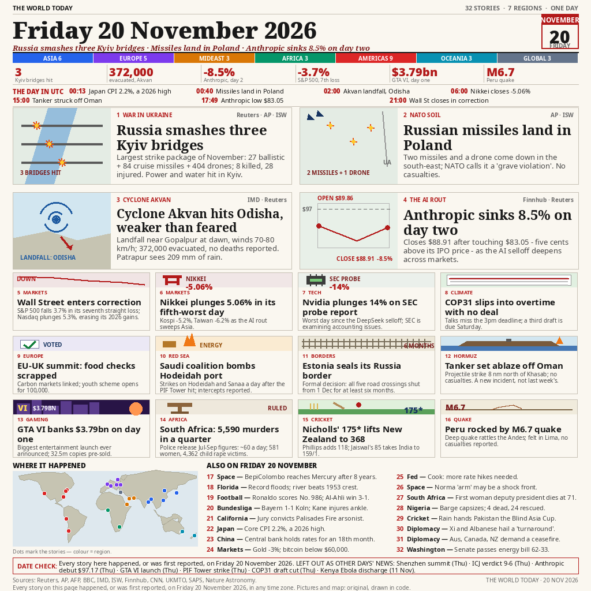

# THE WORLD TODAY — Friday 20 November 2026

make.fun entry for **news-image-20261120** ("Sum up 20 November's world
news in one image"), by **@bosbuilds**.



## The entry

One front-page image, 1024×1024, 32 stories across 7 regions:

- **4 features** — Russia smashes three Kyiv bridges in the war's biggest
  November barrage · Russian missiles land in Poland; NATO calls it a
  "grave violation" · Cyclone Akvan hits Odisha, weaker than feared ·
  Anthropic sinks 8.5% on day two.
- **12 mediums** — Wall Street enters correction, Nikkei plunges 5.06%,
  Nvidia −14% on an SEC probe report, COP31 slips into overtime, EU–UK
  summit, Saudi strikes on Hodeidah, Estonia seals its Russia border,
  tanker set ablaze off Oman, GTA VI banks $3.79bn on day one, South
  Africa's quarterly murder figures, Nicholls' 175\* in Wellington, Peru's
  M6.7 quake.
- **16 briefs**, a 7-beat UTC timeline, a 6-number stat band, a world map
  with one dot per story, and a DATE CHECK box naming the other days' news
  we left out (Shenzhen summit, ICJ verdict, Anthropic debut, GTA VI
  launch, PIF Tower strike — all Thursday 19 Nov; COP31 draft cut — Thu;
  Kenya Ebola discharge — 11 Nov).

Region balance: ASIA 6, EUROPE 5, MIDEAST 3, AFRICA 3, AMERICAS 9,
OCEANIA 3, GLOBAL 3 — no region above 30%.

## Verification

Every story was confirmed against **2+ independent sources dated
20 November 2026** before it went on the page; 42 candidates were
confirmed and 10 cut for region balance, and 60+ candidates were cut as
other days' news, single-source, or unverified. Every figure on the page
carries its source in the verification log (kept in the build work dir,
not in this repo — the log is research notes, the repo is the entry).

Date hygiene is the point: the day's biggest traps are Thursday's news
republished on Friday. The Senate energy bill (voted late Thursday
evening in Washington, first reported 03:19 UTC Friday) is carried as a
brief under the UTC-day convention; the Peru quake (19:09 Friday local,
00:09 UTC Saturday) is dated by its local Friday.

## Files

| File | What it is |
|---|---|
| `entry.png` | The entry image (1024×1024, 242 KB) |
| `draw_20nov.py` | The program that draws it (Python + PIL, Noto fonts) — the image source |
| `main.ts` | The entry program: validates `entry.png` (PNG magic, IHDR 1024×1024, ≤1 MiB) and copies it to `$MAKEFUN_OUTPUT_DIR/entry.png` |
| `package.json` | `{"type": "module"}` |
| `LICENSE` | MIT (from the competition kit starter) |
| `.makefun/owner.json` | Owner wallet |

## Reproduce

```sh
# Regenerate the image from the drawing program (needs Python 3 + Pillow
# + Noto Sans/Serif fonts; the repo ships the rendered PNG as well):
python3 draw_20nov.py entry.png

# Run the entry program (Node 22, stdlib only, no network):
MAKEFUN_OUTPUT_DIR=/output node main.ts
# -> writes /output/entry.png, byte-identical to entry.png
```

Running `main.ts` twice produces identical bytes (it is a validated
copy), and the drawing program is deterministic (no randomness, no
network, no timestamps in the output).
